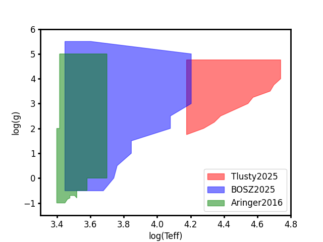
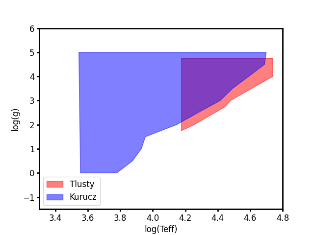

#########################
Stellar Atmosphere Models
#########################

The BEAST physics model uses models of the stellar atmospheres as a function
of stellar temperature, gravity, and metallicity.  These are used to determine
the detailed spectral energy distributions (SEDs) of stars through the use of 
the stellar evolutionary models.  The evolutionary models provide the 
stellar radius allowing the computation of the stellar luminosity converting
the stellar atmosphere surface flux to the integrated flux density from 
each model star.

There is no stellar atmosphere model that accurately computes the stellar 
SEDs for all types of stars.  The highest temperature stars require 
non-LTE calcuations, while lower temperature stars can be computed with 
LTE calculations that are much faster computationally.  As a result, the
BEAST has multile stellar atmosphere grids that can be combined to cover the
full range needed.

For how to use the grids in the BEAST see :doc:`BEAST grid inputs <beast_grid_inputs>`.

Current Grids
=============

The best grids are composed of the Tlusty2025, BOSZ2024, and Aringer2016 grids.

* `Tlusty2025 <https://stsci.box.com/v/tlustyOB2025>`_
    Used the tlusty non-LTE model to compute stellar atmospheres for stars
    with temperatures from 15,000 to 55,000 K for a range of gravities and metallcities
    (`Hubeny et al. 2025 <https://scixplorer.org/abs/2025AJ....169..178H/abstract>`_).
    BEAST grid file created with `physicsmodel/stars/stellar_libraries/gen_tlusty25.py`.

* `BOSZ2024 <https://archive.stsci.edu/hlsp/bosz>`_
    Used the MARCS and ATLAS9 models to compute stellar atmospheres for stars
    with temperatures from 2,800 to 16,000 K for a range fo gravities and metallicities
    (`Szabolcs et al. 2024 <https://scixplorer.org/abs/2024A%26A...688A.197M/abstract>`_).
    BEAST grid file created with `physicsmodel/stars/stellar_libraries/gen_bosz24.py`.

* Aringer2016
    Used the hydrostatic spherical COMARCS model to compute stellar atmosphere_models
    for stars with temperatures from 2,500 to 5000 K for a range of gravities and metallicities
    (`Aringer et al. 2024 <https://scixplorer.org/abs/2016MNRAS.457.3611A/abstract>`_).
    BEAST grid file created with `physicsmodel/stars/stellar_libraries/gen_aringer16.py`.

The coverage and overlap in log(Teff) and log(g) space is shown.  Created using
`physicsmodel/stars/stellar_libraries/plot_multiple_slib_coverage.py`.

Past Grids
==========

The original main grids used in BEAST work were the original tlusty and kurucz grids.  These
have been superceded by the newer, updated current grids descirbed above.

* `Kurucz <http://www.stsci.edu/hst/instrumentation/reference-data-for-calibration-and-tools/astronomical-catalogs/castelli-and-kurucz-atlas>`_
    ATLAS9 model atmospheres by `Castelli & Kurucz (2004; CK04) <https://ui.adsabs.harvard.edu/abs/2004A%26A...419..725C/abstract>`_, the industry
    standard for LTE stellar atmospheres that spans a wide range of L and
    T\ :sub:`eff` parameter space and a broad range of wavelengths (0.10-10.0 micron) at low
    spectral resolution (20 Ang/pix; 2x sampling of R~100 at 4000 Ang).
    Z grid spans -2.5 to +0.5 at 0.5 dex sampling. Models are computed using
    solar abundances from `Grevesse & Sauval (1998; Z=0.0169) <https://ui.adsabs.harvard.edu/abs/1998SSRv...85..161G/abstract>`_.

* `Tlusty <http://tlusty.oca.eu/>`_
    Non-LTE hot star (T\ :sub:`eff` > 15,000 K) atmosphere models (OSTAR and BSTAR) by
    `Lanz & Hubeny (2003 <https://ui.adsabs.harvard.edu/abs/2003ApJS..146..417L/abstract>`_, `2007 <https://ui.adsabs.harvard.edu/abs/2007ApJS..169...83L/abstract>`_), using spectra computed for
    Cloudy
    by Peter van Hoof at R~900 (sampled at R~1800). Z grid spans 5 pts from
    1/10-2x Solar, plus additional 4 pts from 1/1000-1/30x Solar for OSTAR
    grid.  Models are computed using solar abundances from `Grevesse & Sauval (1998; Z=0.0169) <https://ui.adsabs.harvard.edu/abs/1998SSRv...85..161G/abstract>`_.

The coverage and overlap in log(Teff) and log(g) space is shown.  Created using
`physicsmodel/stars/stellar_libraries/plot_multiple_slib_coverage.py --old`.

Misc
====

Stellar atmosphere SEDs in overlapping regions between different grids can be compared
using `physicsmodel/stars/stellar_libraries/comp_stellib_spec.py`.
